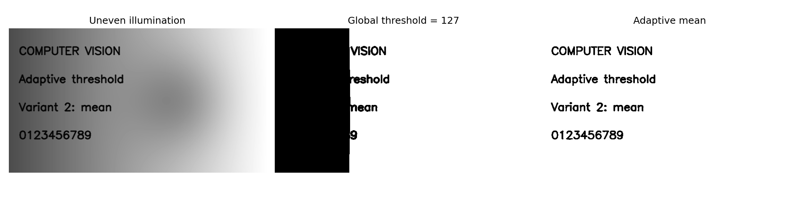

# ЛР1. Адаптивная бинаризация, вариант 2

## Что сделал

Реализовал mean-бинаризацию двумя способами: через OpenCV и самостоятельно на Python.
Для каждого пикселя беру среднюю яркость соседей и вычитаю C. В Python считаю суммы
через интегральное изображение; по краям повторяю крайние пиксели.

## Ход работы

1. Загрузил изображение в оттенках серого. Использовал документ с неравномерным
   освещением и отдельный кадр Mona Lisa: на них проверил работу алгоритма
   с текстом и с обычным изображением.
2. Для каждого пикселя вычислил среднюю яркость в окне 31×31 и вычел 7.
   Если яркость пикселя выше полученного порога, записал 255, иначе 0.
   Так порог подстраивается под освещение соседнего участка изображения.
3. В собственной реализации сначала построил интегральное изображение — таблицу
   накопленных сумм. По четырём значениям этой таблицы получаю сумму окна,
   поэтому не приходится заново обходить всех соседей каждого пикселя.
4. Запустил OpenCV с теми же параметрами. Сравнил результаты по пикселям
   и сохранил изображение разности. Для наглядности рядом сохранил результат
   обычной бинаризации с единым порогом 127.
5. Измерил время на трёх размерах изображения и окнах 15×15 и 31×31.
   Перед замерами выполнил прогрев; по повторным запускам посчитал медиану.
   Картинки, измерения и график сохранил в `results/`.

## Где код и как запустить

- [code/main.py](code/main.py): `adaptive_mean_native` — мой алгоритм,
  `adaptive_mean_opencv` — библиотечный, `timed` — замеры времени.
- Там же сравниваю пиксели, замеряю время и сохраняю картинки.
- `data/` — искусственный документ и кадр Mona Lisa; `results/` — результаты для каждого изображения.

Из корня проекта:

```bash
python -m lab1.code.main
python -m lab1.code.main --input lab1/data/mona_lisa.png --output lab1/results/mona_lisa
python -m lab1.code.main --input image.jpg --output lab1/results/custom
```

## Результат

На основном изображении различий между реализациями: **0 пикселей**.

- 320×180, окно 31: OpenCV 0.050 мс, Python 22.64 мс.
- 640×360, окно 31: OpenCV 0.176 мс, Python 118.61 мс.
- 1280×720, окно 31: OpenCV 0.670 мс, Python 359.08 мс.

Время — медиана 3 запусков после прогрева. Проверил искусственный документ с разным освещением и кадр Mona Lisa.



[Все измерения](results/document/metrics.json) · [График времени](results/document/benchmark.png)

## Вывод

Моя реализация совпала с библиотечной. OpenCV работает быстрее циклов Python.

## Источники

- [Задание](LW1.pdf).
- [OpenCV: пороговая обработка](https://docs.opencv.org/4.x/d7/d4d/tutorial_py_thresholding.html).
