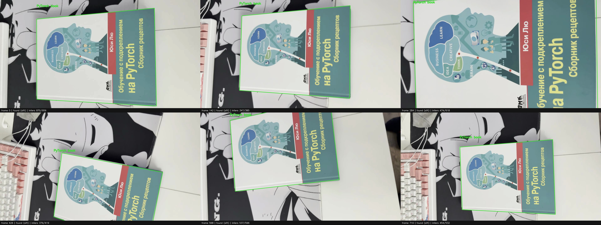

# ЛР2. Трекинг объекта на видео

## Что сделал

Взял объект с первого кадра как эталон. На следующих кадрах сопоставляю точки SIFT,
оцениваю гомографию через RANSAC и рисую рамку с подписью. Если совпадений мало,
сопровождаю точки через LK. Ненадёжную рамку не показываю; продолжаю искать объект.

## Ход работы

1. На первом кадре выделил нужный объект. Для Mona Lisa вырезал прямоугольную
   область; для книги задал четыре угла обложки и выправил перспективу,
   получив прямоугольный эталон. Дальше ищу именно этот объект по его изображению.
2. Перевёл эталон в оттенки серого и вычислил точки SIFT. Для каждой точки
   получил дескриптор — числовое описание рисунка вокруг неё. Сохранил эти
   признаки эталона на весь ролик; у обложки получилось 1776 точек.
3. На каждом кадре снова вычисляю SIFT и сопоставляю дескрипторы с эталоном.
   Для каждой точки сравниваю двух лучших кандидатов: принимаю совпадение,
   если расстояние до первого меньше 0,7 расстояния до второго.
   Так отбрасываю неоднозначные совпадения, например на похожих буквах.
4. По оставшимся парам через RANSAC оцениваю гомографию — преобразование
   координат плоской обложки в текущий кадр. RANSAC исключает ошибочные пары.
   Переношу четыре угла эталона через найденную матрицу и получаю рамку.
   Принимаю её, если есть хотя бы 8 согласованных пар и их доля не меньше 40%,
   а форма рамки и ошибка переноса точек проходят проверки.
5. После успешного поиска выбираю точки внутри рамки и сохраняю состояние
   кадра. Если следующий поиск SIFT не удался, пробую LK (Lucas–Kanade):
   переношу эти точки между соседними кадрами по сходству локальных участков.
   Проверяю перенос вперёд и обратно; точки с ошибкой возврата от 1,5 пикселя
   отбрасываю. По оставшимся оцениваю перенос, поворот и масштаб обложки.
   На следующем кадре всё равно сначала пробую SIFT относительно исходного
   эталона, чтобы уменьшать накопление ошибки сопровождения.
6. Если оба способа не дали допустимую рамку, сбрасываю сопровождение и продолжаю
   поиск на следующих кадрах. Сохраняю видео с контуром и заданной подписью,
   координаты и статус каждого кадра в `frames.jsonl`, итоговые метрики
   в `metrics.json`, а также отдельные кадры и общий просмотр `preview.jpg`.

## Где код и как запустить

- [code/main.py](code/main.py): `PlanarTracker` — поиск и сопровождение,
`rectify_reference` — эталон по четырём углам, `process_video` — обработка и запись.
- [code/run_videos.py](code/run_videos.py) — запуск трёх роликов Mona Lisa и моего видео.
- [data/video_rois.json](data/video_rois.json) — области эталона для этих роликов.
- [code/prepare_video.py](code/prepare_video.py) — рабочая копия моего MOV.

`data/videos/` — ролики задания; `data/own_video/` — исходный MOV, рабочий MP4 и углы эталона.
`results/provided/` и `results/own_video/` — обработанные видео, кадры и метрики.

Из корня проекта:

```bash
python -m lab2.code.run_videos
python -m lab2.code.main --input lab2/data/own_video/working.mp4 --corners 234 122 986 52 999 678 235 635 --label "PyTorch book" --output lab2/results/own_video
```

## Результат

- `mona-lisa.avi`: рамка на 557/558 кадрах; [видео](results/provided/mona-lisa/tracked.mp4).
- `mona-lisa-blur.avi`: рамка на 538/558 кадрах; [видео](results/provided/mona-lisa-blur/tracked.mp4).
- `mona-lisa-blur-extra-credit.avi`: рамка на 401/558 кадрах; [видео](results/provided/mona-lisa-blur-extra-credit/tracked.mp4).
- Моё видео с книгой: рамка на **711/711 кадрах**; [видео](results/own_video/tracked.mp4).

На моём видео все 711 кадров обработаны через SIFT, резервный LK не понадобился.
На обычном ролике Mona Lisa SIFT сработал на 237 кадрах, LK — на 320;
на одном кадре рамка не прошла проверки.

При необходимости пересоздать рабочее видео:

```bash
python -m lab2.code.prepare_video lab2/data/own_video/IMG_7749.MOV
```

Для моего видео сделал копию 1280×720 со всеми кадрами и задал четыре угла обложки на первом кадре.



[Метрики](results/own_video/metrics.json) · [Координаты по кадрам](results/own_video/frames.jsonl)

## Вывод

Проверил трекер на трёх тестовых роликах и своём видео. На сильном размытии бывают
потери объекта; результаты и отказы сохранены по кадрам.

## Источники

- [Задание](LW2_25.pdf).
- [OpenCV: ключевые точки и гомография](https://docs.opencv.org/4.x/d1/de0/tutorial_py_feature_homography.html).
