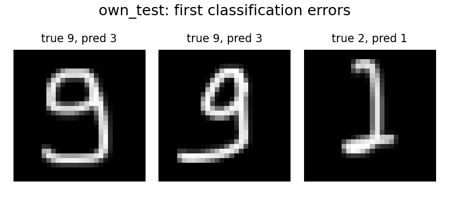

# ЛР3. Классификация рукописных цифр

## Что сделал

Обучил небольшую CNN на MNIST для цифр 0–9. В сети две свёртки на 16 и 32 канала,
pooling и полносвязные слои 64 → 10. Использовал Adam, cross-entropy и dropout 0.25.
Разделил данные на train 55 000 и validation 5 000; официальный test — 10 000.

## Ход работы

1. Загрузил изображения MNIST размером 28×28 и метки цифр. Отделил validation
   от обучающей части с сохранением представительства классов. Перед передачей
   в сеть перевёл яркости в вещественные числа и нормализовал их.
2. В первом свёрточном блоке получил 16 карт признаков, во втором — 32.
   Фильтры обучаются выделять полезные сочетания штрихов. После каждого блока
   ReLU добавляет нелинейность, а max pooling уменьшает размер карт вдвое:
   28×28 → 14×14 → 7×7. Затем преобразую признаки в вектор и через линейные
   слои получаю 10 оценок — по одной для каждой цифры. Ответ — класс
   с максимальной оценкой.
3. Обучал сеть пять эпох, то есть пять полных проходов по train, пакетами
   по 256 изображений. Для каждого пакета вычислял cross-entropy — ошибку
   относительно правильных меток, находил градиенты и обновлял веса через Adam.
   Dropout отключал часть активаций при обучении; при оценке он выключен.
4. После каждой эпохи считал ошибку и accuracy на validation без изменения весов.
   Сохранил модель с минимальным validation loss, затем оценил её на официальном
   test. Записал историю обучения, веса, метрики, матрицу ошибок и примеры ответов.
5. Отдельно проверил 50 собственных цифр. Перед распознаванием определил фон,
   выделил штрихи через порог Otsu и убрал лишние поля. Сохранил пропорции цифры,
   вписал её в область 20×20 на поле 28×28 и выровнял по центру масс.
   Передал изображения в уже обученную модель без дообучения; ответы по каждому
   рисунку сохранил в `own_predictions.csv`.

## Где код и как запустить

- [code/main.py](code/main.py): `DigitCNN` — сеть, `train` — обучение,
  `evaluate_own` — проверка моих цифр, `predict` — одна картинка.
- [code/digits.py](code/digits.py) — MNIST, разбиение и предобработка цифр.
- [Веса модели](results/best_model.pt), мои данные — `data/own_digits.json`.
- [code/collect_digits.html](code/collect_digits.html) — страница сбора цифр.

`data/mnist/` — MNIST; `data/own_digits.json` — мои 50 цифр.
`results/` — веса, история обучения, метрики, ответы и графики.

Из корня проекта:

```bash
python -m lab3.code.main train --epochs 5 --device auto
python -m lab3.code.main evaluate-own --json lab3/data/own_digits.json
```

## Результат

Обучил сеть 5 эпох. Выбрал эпоху 5 по минимальному validation loss.

- Validation: accuracy **98.58%**.
- Официальный MNIST test: accuracy **98.74%**.
- Мои цифры: **47/50**, accuracy **94.00%**, macro-F1 **0.9381**.

Собрал по пять разных примеров каждой цифры. Модель на них не дообучал.



[Все метрики](results/metrics.json) · [Мой тест](results/own_test_metrics.json) · [Ответы по изображениям](results/own_predictions.csv) · [Графики обучения](results/learning_curves.png)

## Вывод

Validation loss снижался на каждой эпохе, выраженного переобучения в этом запуске
не увидел. На моём почерке качество ниже, чем на MNIST.

## Источники

- [Задание](LW3-1.pdf), обычный вариант; [дополнительный вариант](LW3-2.pdf).
- [MNIST](https://github.com/cvdfoundation/mnist), [PyTorch](https://docs.pytorch.org/tutorials/beginner/basics/buildmodel_tutorial.html).
